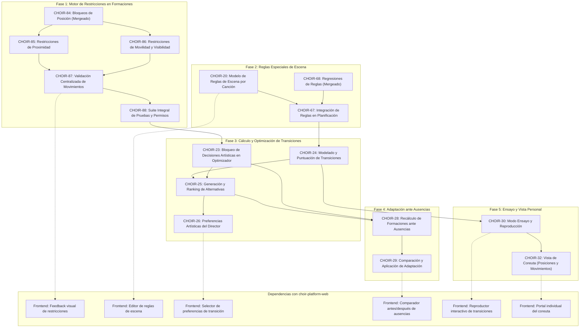

# Roadmap de Ejecución y Dependencias — Backend (choir-platform)

Este documento define el **orden de ejecución recomendado**, las **dependencias técnicas** y las **dependencias cruzadas con el frontend (`choir-platform-web`)** para todos los tickets restantes del proyecto CHOIR.

---

## 1. Estado Actual del Backend en `main`

Los siguientes tickets base ya han sido implementados, probados y mergeados en la rama `main`:

| Ticket | Componente | Descripción | Estado en `main` |
|---|---|---|---|
| **CHOIR-84** | Backend | Bloqueo y desbloqueo de posiciones de coreutas (`/positions/{positionId}/lock`) | ✅ Completado (PR #83) |
| **CHOIR-109** | Backend | Generar posiciones iniciales agrupadas por cuerda vocal en `POST /formations` | ✅ Completado (PR #87) |
| **CHOIR-68** | Backend | Verificación de reglas de escena y regresiones de CHOIR-20 | ✅ Completado (PR #81) |
| **CHOIR-99** | Backend | Limpieza fiable de evaluaciones en PostgreSQL para tests | ✅ Completado (PR #80) |
| **CHOIR-105** | Backend | Migraciones Flyway y compatibilidad de datos de versionado | ✅ Completado (PR #78) |
| **CHOIR-106** | Backend | Matriz integral de aceptación y auditoría de inmutabilidad | ✅ Completado (PR #78) |
| **CHOIR-89** | Épica / Backend | Creación de formaciones predeterminadas por cuerda (cerrada con CHOIR-109 y CHOIR-110) | ✅ Completado |

---

## 2. Mapa y Grafo de Dependencias

---

## 3. Fases de Ejecución Recomendadas (Backend)

### Fase 1: Motor de Restricciones en Formaciones
*Objetivo: Extender la capacidad del escenario para validar no solo posiciones individuales bloqueadas, sino restricciones relativas entre coreutas y condiciones físicas.*

1. **[CHOIR-85](CHOIR-85.md) — Definir y validar restricciones opcionales de proximidad entre coreutas**
   - **Dependencia previa:** CHOIR-84 (ya mergeado).
   - **Alcance:** Modelo de dominio para pares de coreutas `(singerA, singerB)` con distancia euclidiana máxima admisible en una formación. Persistencia hexagonal y endpoints CRUD en `/api/.../formations/{formationId}/constraints/proximity`.
   - **Impacto Frontend:** Provee endpoints para configurar proximidad.

2. **[CHOIR-86](CHOIR-86.md) — Modelar restricciones configurables de movilidad y visibilidad**
   - **Dependencia previa:** CHOIR-84.
   - **Alcance:** Restricciones de movilidad (filas accesibles, sin desniveles) y visibilidad (alturas relativas para evitar tapar integrantes).
   - **Impacto Frontend:** Provee catálogo y endpoints de restricciones de accesibilidad y visibilidad.

3. **[CHOIR-87](CHOIR-87.md) — Validar movimientos contra bloqueos y restricciones de formación**
   - **Dependencias previas:** CHOIR-84, CHOIR-85, CHOIR-86.
   - **Alcance:** Centralizar en la capa de aplicación (`formation.application.usecase`) la validación atómica antes de persistir o mover coreutas. Si se incumple una restricción o bloqueo, responder con error HTTP `400` o `409` estructurado indicando la causa exacta.
   - **Impacto Frontend:** Permite al frontend capturar y mostrar los motivos de rechazo en el escenario.

4. **[CHOIR-88](CHOIR-88.md) — Probar persistencia, permisos y validación de restricciones**
   - **Dependencias previas:** CHOIR-85, CHOIR-86, CHOIR-87.
   - **Alcance:** Suite de pruebas de integración (PostgreSQL / H2) que valide autorización multitenant del director, rechazo de operaciones concurrentes inválidas y consistencia transaccional.

---

### Fase 2: Reglas Especiales de Escena y Planificación
*Objetivo: Integrar las reglas narrativas/artísticas específicas de cada canción al cálculo escénico.*

5. **[CHOIR-20](CHOIR-20.md) — Configurar reglas especiales de escena por canción**
   - **Dependencia previa:** CHOIR-68 (ya verificado).
   - **Alcance:** Exposición y gestión de reglas asociadas a un elemento de repertorio (`repertoireItemId`) dentro de un concierto: salidas en grupos (ej. 4+4), desplazamientos por tandas y agrupaciones específicas.
   - **Impacto Frontend:** Expone endpoints de consulta y edición de reglas de escena.

6. **[CHOIR-67](CHOIR-67.md) — Integrar reglas especiales en la planificación de transiciones**
   - **Dependencias previas:** CHOIR-20 y CHOIR-68. CHOIR-97 aparece como dependencia en la especificación del ticket, pero no tiene spec local; confirmar su existencia y alcance en Jira antes de tratarlo como bloqueante.
   - **Alcance:** Evaluar reglas activas al planificar o recalcular transiciones entre versiones publicadas de formaciones. Generación de advertencias estructuradas ante reglas que no puedan cumplirse, exigiendo decisión explícita del director.

---

### Fase 3: Modelado, Cálculo y Optimización de Transiciones
*Objetivo: Medir, calificar y encontrar las mejores transiciones entre formaciones.*

7. **[CHOIR-24](CHOIR-24.md) — Modelar y puntuar transiciones entre formaciones**
   - **Dependencias previas:** CHOIR-67, snapshots inmutables de versionado (CHOIR-106).
   - **Alcance:** Algoritmo determinístico de cálculo de costes de transición: suma de distancias recorridas, detección de cruces espaciales entre trayectorias, movimientos simultáneos y evaluación de advertencias.

8. **[CHOIR-23](CHOIR-23.md) — Bloquear decisiones artísticas y definir restricciones en optimización**
   - **Dependencias previas:** CHOIR-84, CHOIR-87, CHOIR-88.
   - **Alcance:** Garantizar que el motor de sugerencias u optimización no altere posiciones bloqueadas ni viole restricciones activas.

9. **[CHOIR-25](CHOIR-25.md) — Generar y rankear alternativas de transición**
   - **Dependencias previas:** CHOIR-24, CHOIR-23.
   - **Alcance:** Generación de alternativas viables de reasignación/trayectoria ordenadas por métricas de menor costo y menores cruces.

10. **[CHOIR-26](CHOIR-26.md) — Permitir preferencias artísticas del director en la optimización**
    - **Dependencia previa:** CHOIR-25.
    - **Alcance:** Configuración de pesos ponderados (priorizar compacidad vs menor distancia vs mantener secciones unidas vs evitar cruces).

---

### Fase 4: Adaptación ante Ausencias
*Objetivo: Resolver dinámicamente bajas de último momento sin romper decisiones previas.*

11. **[CHOIR-28](CHOIR-28.md) — Recalcular formaciones y transiciones ante ausencias**
    - **Dependencias previas:** CHOIR-23, CHOIR-24, CHOIR-25.
    - **Alcance:** Excluir al integrante ausente del concierto u obra, conservar invariantes y posiciones bloqueadas, y recalcular las formaciones y transiciones afectadas.

12. **[CHOIR-29](CHOIR-29.md) — Comparar y aplicar adaptación por ausencia**
    - **Dependencia previa:** CHOIR-28.
    - **Alcance:** Endpoints para devolver la comparación (formación previa vs propuesta) y permitir confirmación/publicación manual por el director.

---

### Fase 5: Modo Ensayo y Vista Individual de Coreutas
*Objetivo: Proveer las fuentes de datos y APIs para la simulación visual y la vista móvil/coreuta.*

13. **[CHOIR-30](CHOIR-30.md) — Modo ensayo y reproducción de transiciones**
    - **Dependencia previa:** CHOIR-24.
    - **Alcance:** Endpoint que devuelva los pasos temporales / vectores de desplazamiento de la transición para permitir la simulación paso a paso o continua en el frontend.

14. **[CHOIR-32](CHOIR-32.md) — Vista de coreuta con sus posiciones y movimientos**
    - **Dependencias previas:** Autenticación de integrante/rol coreuta, CHOIR-30.
    - **Alcance:** Endpoint de solo lectura `GET /api/me/concerts/{concertId}/my-positions` según el spec backend de CHOIR-32; verificar el contrato contra Jira antes de implementarlo.

---

## 4. Matriz de Dependencias Cruzadas con `choir-platform-web`

| Ticket Backend | Contrato previsto (verificar implementación) | Ticket Frontend Consumidor | Responsabilidad Frontend |
|---|---|---|---|
| **CHOIR-85** | `POST/GET/DELETE .../constraints/proximity` | **CHOIR-85-WEB** | Selector de pareja de coreutas y distancia máxima. |
| **CHOIR-86** | `POST/GET/DELETE .../constraints/physical` | **CHOIR-86-WEB** | Configuración de restricciones de movilidad o visibilidad. |
| **CHOIR-87** | Respuestas HTTP `400/409` estructuradas en guardado | **CHOIR-87-WEB** | Feedback en escenario (destacar conflicto y mensaje legible). |
| **CHOIR-20** | `GET/POST/PUT .../repertoire/{id}/scene-rules` | **CHOIR-20-WEB** | Panel de reglas de escena y salidas escalonadas. |
| **CHOIR-24 / 25** | `POST .../transitions/evaluate`, `.../alternatives` | **CHOIR-25-WEB** | Vista comparativa de alternativas y métricas (distancia, cruces). |
| **CHOIR-26** | `PUT .../concerts/{id}/optimization-preferences` | **CHOIR-26-WEB** | Sliders / prioridades de criterios para el director. |
| **CHOIR-28 / 29** | `POST .../adaptations/absence/calculate`, `POST .../adaptations/absence/apply` | **CHOIR-29-WEB** | Vista comparativa antes/después y botón de aplicar. |
| **CHOIR-30** | `GET .../transitions/{id}/playback-steps` | **CHOIR-30-WEB** | Reproductor visual paso a paso / animación en el escenario. |
| **CHOIR-32** | `GET /api/me/concerts/{concertId}/my-positions` | **CHOIR-32-WEB** | Portal del coreuta (vista simplificada y personal). |

Las rutas de esta matriz son contratos propuestos por los specs, no una afirmación de que los endpoints ya existan. Verificar Jira y el backend implementado antes de iniciar el trabajo consumidor.
